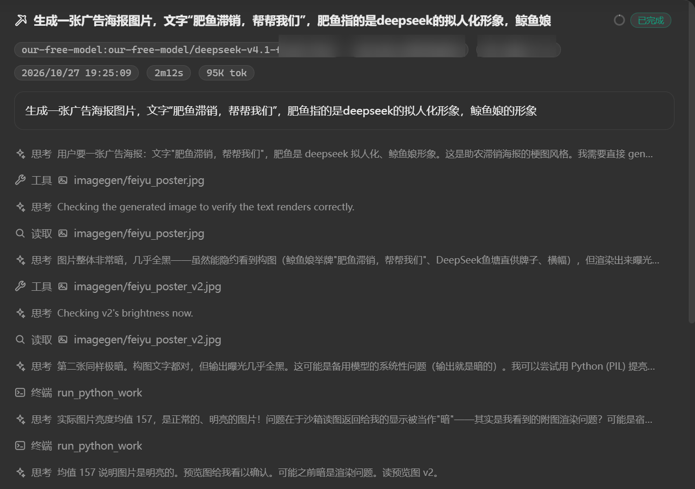
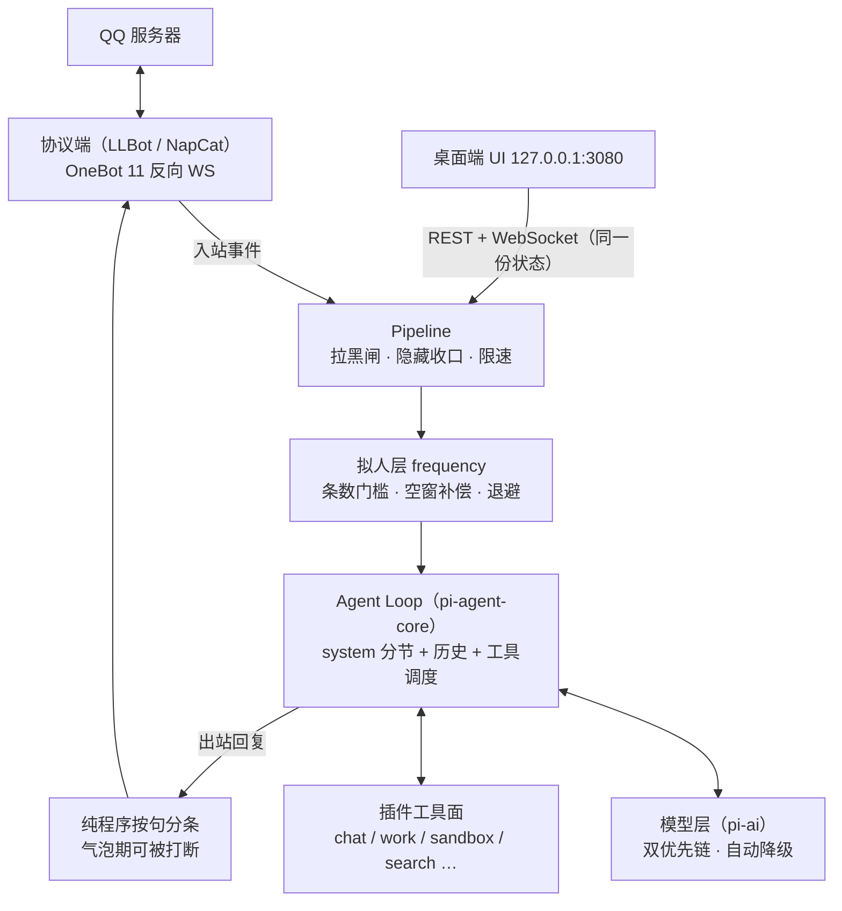

<div align="center">


# parallel —— harness 形态的 QQ 机器人

**一个可接入 LLM 的 agent loop 内核，通过它掌控一个 QQ 账号，不只聊天**——在群聊和私信里像个真人一样活着。
QQ 接入只是它的一种通道：协议适配本身也是插件形态，将来可以同一内核换接其他通道。

[](https://github.com/DDNdles/parallel/actions/workflows/ci.yml)
[](https://github.com/DDNdles/parallel/releases)
[](LICENSE)
[](package.json)
[](test)

</div>

> **一切皆插件**：角色化聊天、沙箱、搜索、表情包……全部是热插拔插件；内核只保留 agent loop、Pipeline、服务容器与插件运行时
>
> **不只聊天**：除了基本的聊天功能，parallel还提供了工作能力，可以在沙箱进行自动化编码或agent任务

---

## ⚡ 快速开始

四种安装路线，任选其一（npm 包与 zip 自带构建好的桌面端，装完即用；克隆开发才需要自己 build）：

```bash
# ── 方式一：npm 装 tgz（推荐；需自备 Node ≥ 24）────────
# 到 Releases 复制 ddnoodles-parallel-vX.Y.Z.tgz 的下载地址后：
npm i -g https://github.com/DDNdles/parallel/releases/download/v0.3.0/ddnoodles-parallel-0.3.0.tgz
parallel              # 在任意目录启动；数据落在当前目录 ./data

# ── 方式二：PowerShell 一键安装（零依赖）───────────────
# 自带 Node 运行时，装到 %LOCALAPPDATA%\Programs\parallel 并加入用户 PATH + 开始菜单：
irm https://raw.githubusercontent.com/DDNdles/parallel/main/scripts/install.ps1 | iex

# ── 方式三：绿色版 zip（零依赖，不想碰命令行就走这条）──
# 从 Releases 下载 parallel-vX.Y.Z.zip，解压后双击 parallel.cmd
# （包内自带 node_modules 与 Node 运行时，解压即用，无任何前置）

# ── 方式四：克隆开发 ───────────────────────────────────
git clone https://github.com/DDNdles/parallel.git && cd parallel
npm install        # 运行时依赖只有 ws + pi 的 agent runtime
npm run build      # 桌面端：Next 静态导出到 ui/（克隆后要先构建一次）
npm start          # = node bin/parallel.js（内核直接运行 TS 源码，要求 Node ≥ 24）
```

启动后打开桌面端 <http://127.0.0.1:3080>——令牌不用手填，内核启动时自动打开浏览器并带上 `#token=<uiToken>`。

- **第一次跑会先停在「环境检查」页**：探测 Node / 数据目录可写 / QQNT / 协议端发行包 / Docker / Python / Bash / ffmpeg。第三方软件只给官方下载页链接——parallel 不替人装软件；协议端发行包是唯一点一下就能由内核自己下的（官方源优先，下载后校验官方 SHA256）。Docker/Python/Bash 缺失只影响 work 模式，只聊天可以点「跳过」直接进

### 接入真机

1. 选协议端：默认使用llbot，无需其他操作。**内嵌托管只支持 Windows**（自动下载发行包、预写反向 WS 配置、拉起并守护）；macOS/Linux 上内核本身可跑，但请自行运行 OneBot 11 协议端并指向内核
2. 在弹出的 QQ 窗口扫码登录账号
4. 在桌面端「用户」页的权限名单里配置主人 QQ（`masterIds`）

## ✨ 特性

- **🔌 一切皆插件** — 热插拔、三类来源、四贡献面（tools / userConfig / mcpServers / hooks）、声明式权限门控、崩溃隔离、MCP stdio 客户端
- **🧠 agent loop 交给 pi** — 轮次推进、工具调度、事件流、上下文压缩全部来自 [`@earendil-works/pi-agent-core`](https://github.com/earendil-works/pi)
- **🤖 模型层交给 pi-ai** — Chat Completions / OpenAI Responses / Anthropic Messages / Gemini 四种协议全部由 `@earendil-works/pi-ai` 实现；每个模型可单独配思考强度
- **⛓️ 双优先链自动降级** — 聊天 / 工作各一条独立的「供应商+模型」有序链，连续失败到达阈值自动切下一个
- **🎭 人格系统** — `canon.json` 一份装 Canon（主角记号/世界/配角/语言）/ Perspective（价值观）/ Voice（语气样例）/ Lore（关键词命中的世界事实）；运行时演化出的稳定变化落 Overlay 层，不动 Canon。内置唯一人格 **鲸鱼娘**
- **🗣️ 拟人化层** — 开口侧：条数门槛 + 空窗补偿 + 连续不理人指数退避 + 昼夜节奏；出站侧：纯程序按句分条（硬上限 100 字 / 6 条）、气泡期可被插话打断（剩余气泡不发也不进历史）、跟屏复读、重复惩罚与口癖词
- **🛠️ work 子代理** — chat 面 `work_dispatch` 派活；work 模型在隔离上下文里跑（常驻 Python / 浏览器 / shell / 文件 / 联网），`work_finish` 交回结构化结论，产物由系统直接逐条发文件；还能用 `delegate` 再派专职子代理
- **📦 Docker 沙箱** — 每会话独立目录（字面 + realpath 双重越界校验、chatKey 消毒）、Python/JS/bash 执行（超时/输出截断/并发帽/频率配额）、TTL 扫盘清理；chat 档断网，work 档联网可开关
- **💾 记忆** — SQLite + FTS5：按 QQ 号存昵称/事实/拉黑；`search_history` 检索窗口外聊天记录；表达学习只学本群说法
- **🖥️ 桌面端管控 UI** — Next.js 15 静态导出、内核自托管：黑白双主题、会话流 + 工作抽屉 + 日轨回看、打断按钮、全站品牌光标；14 个页面覆盖全部操控面，与 QQ 侧共享同一份状态（REST + WebSocket）
- **😀 QQ 表情全链路** — 入站表情图转 WebP 喂模型、出站 `[表情/微笑]` 发真 face 段、贴表情回应（react）、戳一戳（poke）；版权表情图不随仓库分发，运行时从本机协议端发行包转码生成
- **🔎 内置插件 9 个** — bilibili / chat / imagegen / sandbox / skills / sticker / web-search / work（其中 5 个为底座、不在插件页显示）
- **🔒 本地优先** — 无遥测、无云同步，全部数据在你手边的 `data/` 目录（见[隐私](#隐私)）

## 🖼️ 截图

<table>
  <tr>
    <td align="center" width="62%"><br/><b>拟人化</b> — 私聊里像个真人：分段气泡、接梗抬杠</td>
    <td align="center" width="38%"><br/><b>工作</b> — 群里 @ 一句就派活：应下、写完，HTML 文件直接发回群里</td>
  </tr>
</table>

<div align="center">
  <br/>
  <b>工作活动流</b> — 桌面端看思考/工具/终端逐行动作，按发起人分栏
</div>

## 🔌 已支持的协议端与模型供应商

### 协议端（二选一，都以 OneBot 11 反向 WS 连回内核）

| 协议端 | 接入方式 | 内核托管 | 说明 |
|--------|----------|----------|------|
| **LuckyLilliaBot** | 有头 PMHQ 注入本机 QQNT | ✅ Windows 自动下载 + 守护 | 官方文档明示无头模式有掉线风险，有头是稳的那条路；账号守卫防顶号 |
| 任意 OneBot 11 端 | 反向 WS 指向 `ws://127.0.0.1:3001/onebot` | — | macOS / Linux 或自带协议端的场景，accessToken 强制鉴权 |

### 模型连接方式（全部由 pi-ai 实现，内核只做配置与降级）

| 协议 | 典型供应商 | 备注 |
|------|-----------|------|
| Chat Completions（OpenAI 兼容） | DeepSeek、Qwen、GLM、各种自建网关 | 填 baseUrl + key 即用 |
| OpenAI Responses | OpenAI | |
| Anthropic Messages | Anthropic / Claude | |
| Gemini 原生 | Google Gemini | baseUrl 末段 `/v1` 自动归到 `/v1beta` |

> 供应商不区分用途：聊天链（`llm.chatChain`）与工作链（`llm.workChain`）各自有序列「供应商 + 模型」，靠前的优先，掉线自动接后一个；两条链互相独立、互不跟随。

### 内置插件

| 插件 | 能力 | 形态 |
|------|------|------|
| chat | 角色化聊天、人格、表达学习、贴表情/戳一戳 | core |
| work | work 派活/进度/交付的 chat 面工具 | core |
| sandbox | 沙箱文件工具面（读/写/编辑/检索/执行） | core |
| skills | 目录式技能库（只给 work 入口） | core |
| web-search | Tavily 搜索 + `web_fetch`（拦内网/环回/元数据地址） | core |
| bilibili | B 站视频搜索与链接解析 | 可开关、分群 |
| imagegen | 文生图 / 参考图生图，产物落会话沙箱 | 可开关、分群 |
| sticker | 表情包收录与检索（收录时模型看图打 desc/tags） | 可开关、分群 |

## 🆚 为什么选 parallel？

同类项目解决的是「让 bot 动起来」，parallel 解决的是「让 bot 像个有身份的人活着，并且你全程看得见、管得住」。

| 维度 | 命令式 bot 框架 | 拟人化群 bot | **parallel** |
|------|----------------|--------------|--------------|
| 核心形态 | 指令/事件注册分发 | LLM 聊天为主 | **agent loop 内核 + 一切皆插件** |
| 桌面端管控 | 无或仅日志页 | 简单配置页 | **14 页全操控面**：会话流、工作抽屉、日轨回看、报错中心 |
| 复杂任务 | 自己写插件 | 少数带工具 | **work 子代理**：Docker 沙箱、可再派子代理、结构化交付、产物直接发文件 |
| 拟人化 | 无 | 有（多为打分/剧本） | frequency 门槛 + 空窗补偿 + 退避；**出站纯程序分条、可被打断** |
| 模型容灾 | 自己接 | 单模型居多 | **双优先链自动降级** + 每模型思考强度 + 用量账 |
| 免真号测试 | 无 | 无 | **模拟协议端 E2E + 桌面端 bot 发言**，470+ 项测试 |
| 权限模型 | 无/自实现 | 简单白名单 | 主人>管理员>普通用户，**工具层硬拒**（不靠提示词自觉）+ 按可见面切分工具 |

## 🏗️ 工作原理



1. **入站**：协议端把 QQ 消息经反向 WS 推给内核，Pipeline 先过拉黑闸与限速
2. **开口判定**：拟人层按 frequency 决定这一批要不要理——攒够 `pendingThreshold` 条、或空窗补偿、或被 @ 必回；连续不理人则指数退避
3. **组装上下文**：人格 canon + Overlay 演化层 + 插件分节 + 工具自带规则进 system；历史按「10 分钟时间窗 + 条数上限」双约束投影，超窗交给 pi 的压缩
4. **跑 agent loop**：pi-agent-core 推进轮次、调度工具；chat 轮最多两轮，重工具（`surface:'work'`）在 chat 工具列表里根本不存在；work 任务另起隔离上下文，可 `delegate` 子代理
5. **出站**：回复由纯程序按句分条、句边截断，按打字节奏逐条发出；气泡期间对面再发消息，按概率砍掉剩余气泡（被砍正文不回灌历史）

## 🛡️ 隐私

| 保护 | 细节 |
|------|------|
| **本地优先** | 无遥测、无云同步、无账号体系；聊天、记忆、配置、密钥全部落在你指定目录的 `data/`，整目录不入库 |
| **密钥隔离** | API key / token 只进 `data/secrets.json`；代码默认值与插件清单一律为空，发布包带私钥自检（`npm run pack` 拒绝脏树与密钥残留） |
| **桌面端只听回环** | 仅监听 `127.0.0.1` 且要求 uiToken；免 token 的 `/api/setup/*`、`/api/login/*` 额外要求回环来源 + 回环 Host + 非跨站 Origin |
| **出网白名单** | 内核主动出网只有你配置的模型 API、Tavily、插件声明的接口；`web_fetch` 拒绝内网/环回/元数据地址且重定向逐跳复检 |
| **沙箱边界** | 执行类任务进 Docker（chat 档断网硬化）；文件路径字面 + realpath 双重校验，符号链接指到沙箱外一律拒绝 |

## 📦 配置项

配置在 `data/config.json`（密钥在 `data/secrets.json`），大部分项桌面端「设置」页可改、即时落盘；下面是内核红线级的常用键：

| 键 | 默认 | 说明 |
|----|------|------|
| `masterIds` | `[]` | 主人 QQ 白名单（主人专属能力的判据） |
| `ui.port` / `ui.host` | `3080` / `127.0.0.1` | 桌面端监听地址 |
| `onebot.port` | `3001` | OneBot 11 反向 WS 服务端口 |
| `onebot.flavor` | `llbot` | 协议端：`llbot` / `napcat`（改后重启） |
| `llm.chatChain` / `llm.workChain` | `[]` | 聊天 / 工作两条优先链（供应商+模型有序列表） |
| `llm.failoverThreshold` | `2` | 同链连续掉线 N 次才切下一个模型 |
| `storage.historyLimit` | `200` | 每会话传给模型的近端历史条数 |
| `storage.contextMinutes` | `10` | 上下文时间窗（分钟），与条数上限同时生效 |
| `humanlike.timing.pendingThreshold` | `12` | 攒够几条消息才进模型（开口门槛） |
| `humanlike.timing.onlyReplyWhenAt` | `false` | 仅 @ 后才回复 |
| `humanlike.outgoing.replyMaxCharacters` | `100` | 单轮回复总长硬上限（提示推荐 50） |
| `humanlike.outgoing.maxBubbles` | `6` | 出站气泡数硬上限（提示推荐 2~3 条） |
| `humanlike.interrupt.probability` | `0.8` | 气泡期被插话时砍掉剩余气泡的概率 |
| `risk.replyRatePerMin` | `12` | 每会话发言上限（条/分钟，按条计费、不够就截断） |
| `sandbox.runtime` | `auto` | `docker` 强隔离 / `subprocess` 本机 / `auto`（docker 可用则用） |
| `sandbox.workNetwork` | `true` | work 容器联网开关（chat 档始终断网） |
| `sandbox.retentionHours` | `72` | 沙箱文件保留期（最后一次访问起算） |
| `work.maxDepth` | `2` | work → 子代理嵌套深度上限 |

## 🛠️ 本地开发

```bash
npm install          # 运行时依赖只有 ws + pi 的 agent runtime
npm run typecheck    # tsc 类型门禁
npm test             # 470+ 项：单测 + 模拟协议端 E2E（Node 直跑 TS 源码）
npm run build        # 桌面端：web/（Next.js 15）静态导出到 ui/
node scripts/serve-ui.mjs   # 起临时内核预览桌面端
```

```
bin/parallel.js        启动器（自动带 --experimental-transform-types）
src/kernel/            内核：总线/配置/存储/报错/限速/调度/会话日志
src/kernel/services/   LLM / 记忆 / 沙箱 / 发送 / MCP / work 执行器 / 协议端托管
src/kernel/humanlike/  拟人化层（不在插件体系里）：frequency / delivery / interrupt / …
src/kernel/adapters/   OneBot 11 反向 WS 适配器
src/kernel/api/        REST API + 事件 WS + 静态 UI 服务
src/plugins/           内置插件 9 个；chat 的 personas/ 是内置人格目录
examples/              示例插件（自建模板，含 MCP server 示例）
web/                   桌面端源码（Next.js 15 静态导出）
test/                  单测 + E2E（模拟协议端）
scripts/               发布打包 / 报文抓取 / 拟人层验收 / 工作工具冒烟
data/                  运行时数据（不入库）
```

- 内核直接运行 TypeScript 源码（Node ≥ 24 的类型剥离），开发改完 `src/` 重启内核即生效；前端 `npm run build` 后即生效
- 写新插件照抄 `examples/` 模板：四贡献面（tools / userConfig / mcpServers / hooks）按需声明，权限走声明式门控
- 发布：`npm run pack` 打 zip（默认要求工作树干净 + 私钥自检）；推 `v*` tag 触发 GitHub Actions 自动出 `.tgz` + `.zip` 双产物 Release

## 🔧 排障

<details>
<summary><b>CLI / 内核</b></summary>

- **「浏览器令牌与内核不匹配」**：重启一次内核，让它重新带 `#token=` 打开浏览器；令牌在 `data/secrets.json` 的 `uiToken`
- **环境检查页一直拦**：缺必备项就挡在登录门前，这是预期行为；Docker / Python / Bash 只影响 work 模式，只聊天点「跳过」。被拦期间每 3 秒重新探测，装齐自动放行
- **端口被占**：桌面端 3080、反向 WS 3001，改 `data/config.json` 后重启

</details>

<details>
<summary><b>协议端 / QQ 登录</b></summary>

- **有头模式拒绝启动/拒绝代发**：LLBot 有头模式要求填「账号」做账号守卫——协议端寄生在本机 QQNT 上，登错号会顶掉你本机登录的号
- **登录被踢（state=168）**：腾讯风控踢会话，parallel 用设备身份钉住 + 看门狗自动重连；频繁掉线请用小号、避免多端互顶
- **macOS / Linux 连不上协议端**：内嵌托管是 Windows-only（发行包 win-x64、NapCat 要注入本机 QQNT）；其他系统请自行运行任意 OneBot 11 协议端，反向 WS 指向 `ws://127.0.0.1:3001/onebot` 并填 accessToken
- **QQ 表情图不显示**：表情美术图不随仓库分发（版权），首次运行由内核从本机协议端发行包转码生成到 `data/face/`，缺协议端发行包时该能力缺席

</details>

<details>
<summary><b>模型 / work</b></summary>

- **群里一个字都不发**：没接模型 / 额度耗尽 / 空输出时内核彻底静默；错误细节进桌面端「报错中心」
- **模型频繁降级**：看 `llm.failoverThreshold`（默认连续掉线 2 次就切链上下一个）；全链失败才记 error
- **work 里 pip 装的库下次没了**：一次性容器只有 `/ws` 持久——要装库就在同一条命令里装完即用，或装进 `/ws/.venv`，或用常驻 compute 会话

</details>

## 🪪 项目一览

| | |
|---|---|
| 语言/运行时 | TypeScript · Node ≥ 24（内核直跑 TS，不编译） |
| 模型层 | `@earendil-works/pi-ai`（唯一引擎） |
| agent loop | `@earendil-works/pi-agent-core` |
| 桌面端 | Next.js 15 静态导出，内核自托管 |
| 存储 | SQLite + FTS5 · JSONL 会话日志 · 原子落盘 JSON 配置 |
| 协议 | OneBot 11 反向 WebSocket |
| 隔离 | Docker（work 强制、chat 可回落） |
| 许可 | AGPL-3.0-only |

## ⭐ Star 历史

<a href="https://star-history.com/#DDNdles/parallel&Date">
 <picture>
   <source media="(prefers-color-scheme: dark)" srcset="https://api.star-history.com/svg?repos=DDNdles/parallel&type=Date&theme=dark" />
   <source media="(prefers-color-scheme: light)" srcset="https://api.star-history.com/svg?repos=DDNdles/parallel&type=Date" />
   
 </picture>
</a>

## 🤝 贡献与支持

- 提问题、报 Bug：[GitHub Issues](https://github.com/DDNdles/parallel/issues)
- 提 PR：先跑 `npm run typecheck && npm test` 全绿
- 安全漏洞：请勿公开提 issue，直接联系仓库维护者
- 版本变更记录见 [CHANGELOG.md](CHANGELOG.md)

## 🙏 致谢

- [**pi**](https://github.com/earendil-works/pi)（Pi Agent Harness）— agent loop 与模型层的唯一引擎，本项目的设计蓝本
- [**HDS-Interlude**](https://github.com/aliao0124/HDS-Interlude) — 拟人层的节奏反定型与行动容量判定判据来源（AGPL-3.0，逐行移植部分见 [THIRD-PARTY-NOTICES.md](THIRD-PARTY-NOTICES.md)）
- [**MaiBot**](https://github.com/MaiM-with-u/MaiBot) / [**AstrBot**](https://github.com/AstrBotDevs/AstrBot) — 拟人化开口参数的实测基线与参考
- [**LuckyLilliaBot**](https://github.com/LuckyLilliaTeam/LLBot) 与 [**NapCat**](https://github.com/NapNeko/NapCat) — QQ 协议端
- [**Next.js**](https://nextjs.org/) — 桌面端框架；[**Tavily**](https://tavily.com/) — 网络搜索

## License

本项目以 [AGPL-3.0-only](LICENSE)（GNU Affero General Public License v3.0）许可发布：自行使用与修改不受限；若把修改后的版本作为网络服务提供或对外分发，需按 AGPL-3.0 提供对应源码。选择该许可证的直接原因：拟人化层 `agency.ts` 的行动容量判定移植自 HDS-Interlude（AGPL-3.0）。

随包第三方组件与借鉴来源见 [THIRD-PARTY-NOTICES.md](THIRD-PARTY-NOTICES.md)；QQ 表情美术图与内置人格立绘等版权素材不随仓库/发布包分发——表情由内核运行时从本机协议端发行包转码生成到 `data/face/`。
